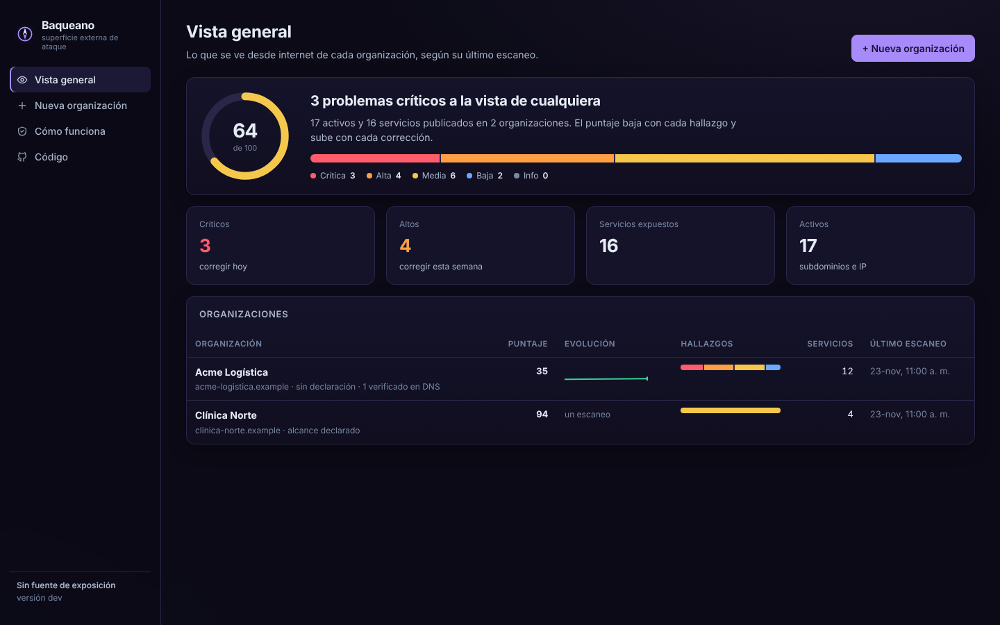

# Baqueano

**Superficie externa de ataque, con responsable y registro de auditoría.** Descubre lo que una organización tiene expuesto en internet, lo prioriza y avisa qué cambió desde el último escaneo.
*External attack surface monitoring with an accountable scope: passive discovery (Certificate Transparency, DNS), exposure from Shodan, explained findings and change tracking.*

[](https://github.com/ulisespignatelli/baqueano/actions/workflows/ci.yml)
[](https://ulisespignatelli.github.io/baqueano/)




**[Ver la demo →](https://ulisespignatelli.github.io/baqueano/)** (organizaciones ficticias)

> El *baqueano* es el que conoce el terreno palmo a palmo: sabe por dónde se puede pasar, dónde están los pasos olvidados y qué cambió desde la última vez. Eso hace esta herramienta con lo que tu organización tiene expuesto en internet.

## La pregunta que responde

*¿Qué ve un atacante de nosotros desde internet, qué es grave y qué cambió desde ayer?*

Las organizaciones acumulan subdominios olvidados, servidores de prueba que quedaron publicados, un RDP abierto "por un rato" y certificados que nadie renueva. Los atacantes los encuentran con las mismas fuentes públicas que usa Baqueano. La diferencia es quién los ve primero.

## Qué hace

1. **Define el alcance con un responsable.** Cargás los dominios y redes de una organización y aceptás una declaración de responsabilidad con tu nombre: "soy responsable de estos activos o tengo autorización de su dueño". Queda en un historial de auditoría, y cada informe dice con qué autorización se hizo. Opcionalmente, el dueño puede **verificar** el dominio publicando un TXT `baqueano-verify=<token>`.
2. **Descubre los activos sin tocarlos:** los subdominios salen de Certificate Transparency y se resuelven con DNS público. Si un subdominio apunta a una CDN o un SaaS, su IP **no** se consulta, porque es del proveedor.
3. **Mira la exposición con datos de Shodan:** puertos, productos, versiones, certificados y vulnerabilidades de cada IP propia. Con una cuenta de Shodan, la consulta por IP no consume créditos; sin cuenta usa InternetDB, la API gratuita.
4. **Convierte lo que ve en hallazgos explicados**, cada uno con qué pasa, por qué importa y cómo se corrige:

| Tipo | Ejemplos |
|---|---|
| Servicios que no deberían estar en internet | RDP, SMB, Telnet, VNC, bases de datos, Docker/Kubernetes, **protocolos industriales**, FTP, SNMP, LDAP |
| Vulnerabilidades | priorizadas por **KEV** (explotación activa) y **EPSS**; las inferidas por la versión se marcan «por confirmar» |
| TLS | certificados vencidos o por vencer, autofirmados, TLS 1.0/1.1 |
| DNS | **subdominios tomables**: CNAME a un servicio de terceros que ya no existe |
| Higiene | paneles de administración públicos, software sin soporte, sitios solo HTTP |

5. **Sigue la evolución:** un puntaje de 0 a 100 por organización, y en cada escaneo qué servicios se abrieron o cerraron y qué hallazgos aparecieron o se resolvieron.

| Hallazgos con su detalle | Cambios desde el escaneo anterior |
|---|---|
|  |  |

## Uso

```bash
git clone https://github.com/ulisespignatelli/baqueano && cd baqueano
make build                       # requiere Go 1.22+ y Node 20+
cp .env.example .env             # y completá SHODAN_API_KEY (opcional)
./bin/baqueano serve             # panel en http://127.0.0.1:8080
```

En el panel: **Nueva organización** (dominios, redes y la declaración de responsabilidad) → **Escanear ahora**.

También por consola:

```bash
baqueano org add "Mi empresa" miempresa.com --responsable "Tu Nombre" --red 203.0.113.0/24
baqueano org verify <ID>                         # verificación DNS opcional
baqueano scan <ID>                               # resumen en la terminal
baqueano scan <ID> --source internetdb           # sin cuenta de Shodan
```

## Principios

- **Alcance con responsable:** nada se analiza sin una declaración con nombre o una verificación DNS, y todo queda en el historial de auditoría. Solo subdominios de lo cargado, redes de hasta un /20 ([ADR 0001](docs/adr/0001-autorizacion-verificable.md)).
- **Solo datos pasivos y nunca IP de terceros** ([ADR 0002](docs/adr/0002-solo-pasivo-sin-terceros.md)).
- **Prudente con lo que afirma:** lo confirmado se distingue de lo inferido por la versión.
- **La clave de Shodan no sale del equipo:** ni en errores, ni en registros, ni en el repositorio ([ADR 0004](docs/adr/0004-secretos.md)).

## Arquitectura

Monorepo con la misma base que [cryptoinv](https://github.com/ulisespignatelli/cryptoinv): backend en Go hexagonal y solo con biblioteca estándar, panel en React embebido en el binario, contrato OpenAPI del que se generan los tipos, y demo en GitHub Pages con el mismo panel ([ADR 0003](docs/adr/0003-arquitectura.md)).

```
api/openapi.yaml            contrato
backend/internal/
  domain/                   modelo y puntaje
  scope/                    verificación DNS, redes declaradas
  discovery/                Certificate Transparency + DNS
  exposure/                 Shodan (API) e InternetDB
  rules/                    hallazgos
  app/                      casos de uso, escaneo en segundo plano, cambios
  adapters/                 almacenamiento, API HTTP + panel
  demodata/                 escenario ficticio sobre el pipeline real
web/src/features/           una carpeta por pantalla
```

La demo y los tests usan un escenario **ficticio** que pasa por el pipeline real: dominios `.example` (RFC 2606), IP de documentación (RFC 5737) y CVE inventadas (`CVE-2099-*`). Solo las fuentes externas están simuladas. Las respuestas de la API se validan contra el contrato OpenAPI.

```bash
make test    # Go con detector de condiciones de carrera + tipos y tests del panel
make lint
```

## Hoja de ruta

- [x] Descubrimiento, exposición con Shodan, hallazgos, cambios, panel y demo
- [ ] Escaneos programados y alertas (correo, Slack, webhook)
- [ ] Postura TLS y preparación post-cuántica (integración con [cryptoinv](https://github.com/ulisespignatelli/cryptoinv))
- [ ] Observatorio global: exposición industrial agregada por país y protocolo, sin IP
- [ ] Informe ejecutivo en PDF

## Licencia

MIT
