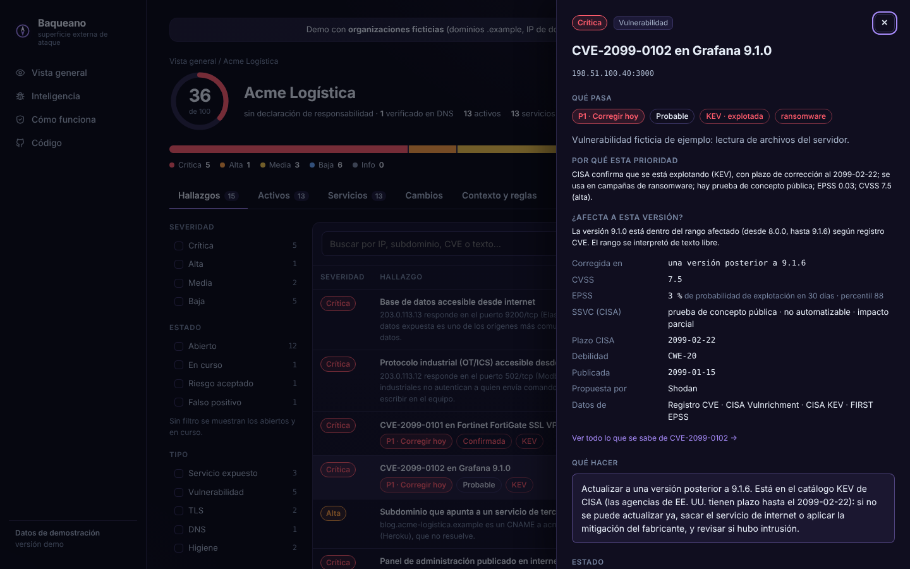
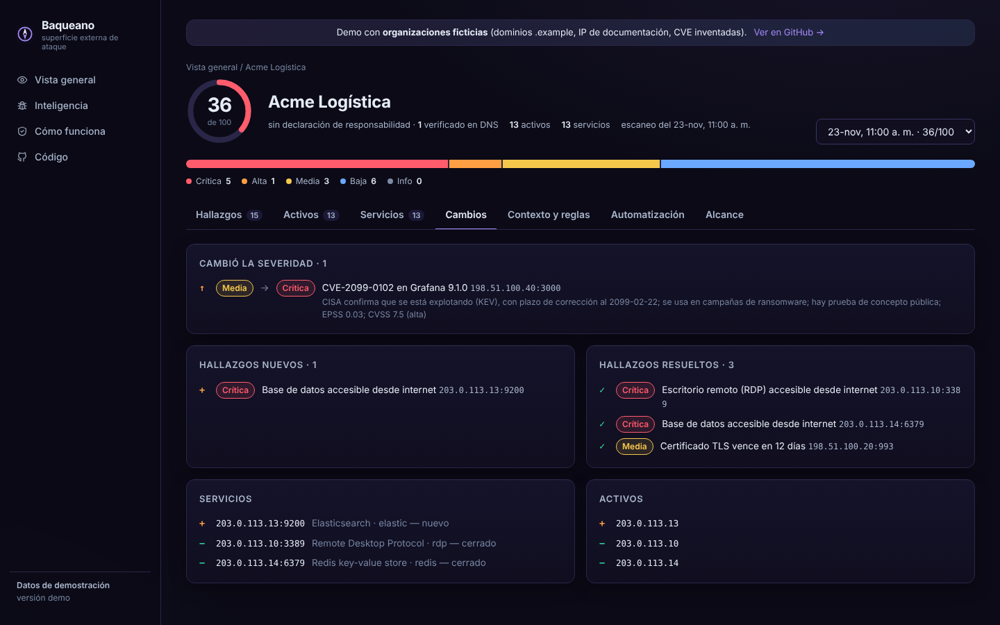
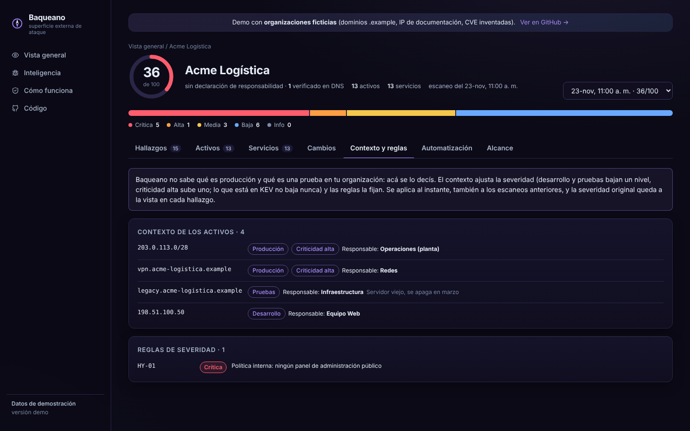
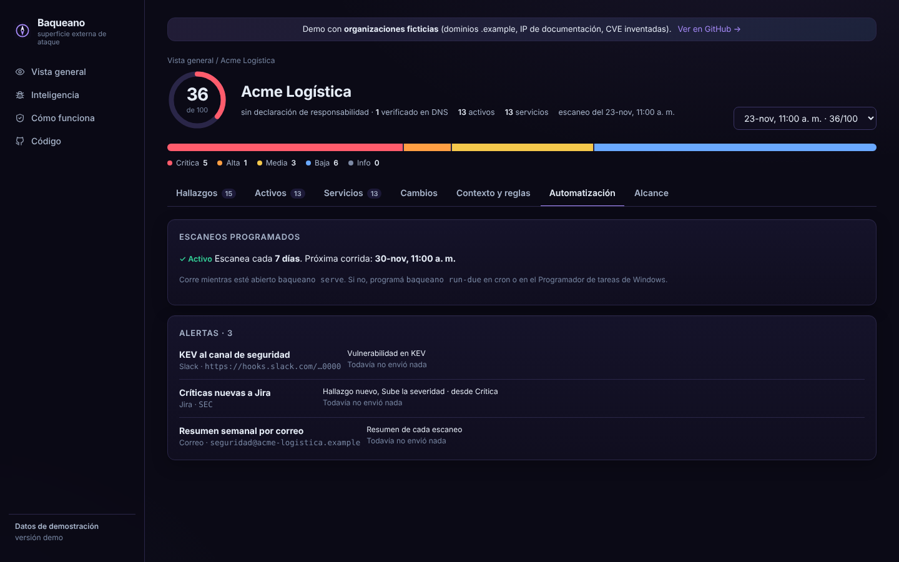
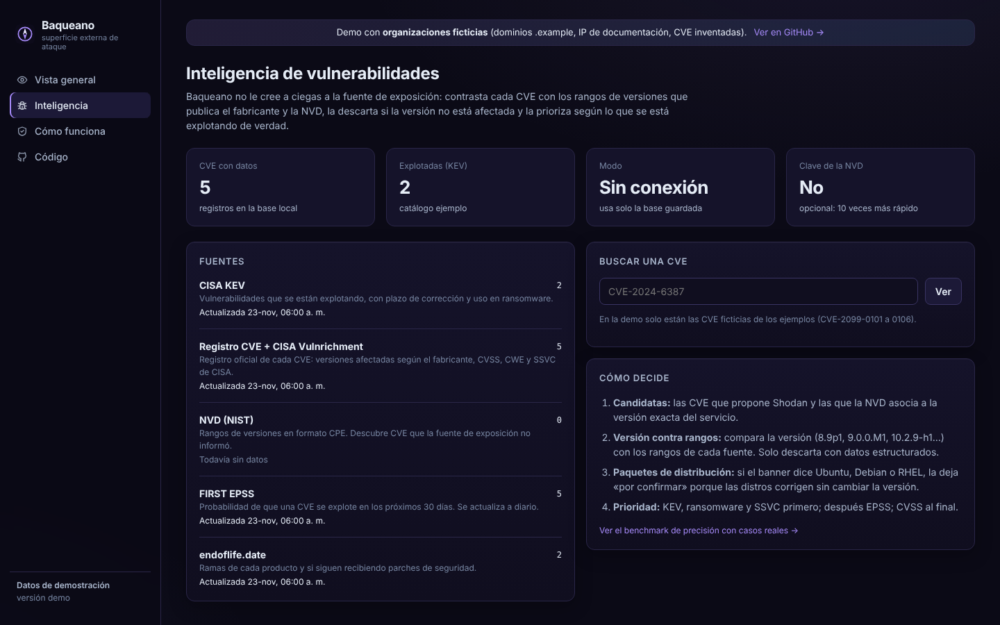

# Baqueano

**Gestión de la superficie externa de ataque con inteligencia de vulnerabilidades propia.** Descubre lo que una organización tiene expuesto en internet con varias fuentes, **verifica cada CVE contra la versión real**, la prioriza por riesgo de explotación y por el contexto de tu organización, y avisa a Slack, Teams, correo o Jira cuando algo cambia.
*External attack surface monitoring with its own vulnerability intelligence engine: version-range verification against the CVE record, CISA Vulnrichment and NVD; prioritization with KEV, EPSS and SSVC; a reproducible precision benchmark.*

[](https://github.com/ulisespignatelli/baqueano/actions/workflows/ci.yml)
[](https://ulisespignatelli.github.io/baqueano/)

[](https://github.com/ulisespignatelli/baqueano/releases)


**[Ver la demo →](https://ulisespignatelli.github.io/baqueano/)** (organizaciones ficticias)

> El *baqueano* es el que conoce el terreno palmo a palmo: sabe por dónde se puede pasar, dónde están los pasos olvidados y qué cambió desde la última vez. Eso hace esta herramienta con lo que tu organización tiene expuesto en internet.

## La pregunta que responde

*¿Qué ve un atacante de nosotros desde internet, qué es grave y qué cambió desde ayer?*

Las organizaciones acumulan subdominios olvidados, servidores de prueba que quedaron publicados, un RDP abierto "por un rato" y certificados que nadie renueva. Los atacantes los encuentran con las mismas fuentes públicas que usa Baqueano. La diferencia es quién los ve primero.

## Qué hace

1. **Define el alcance con un responsable.** Cargás los dominios y redes de una organización y aceptás una declaración de responsabilidad con tu nombre: "soy responsable de estos activos o tengo autorización de su dueño". Queda en un historial de auditoría, y cada informe dice con qué autorización se hizo. Opcionalmente, el dueño puede **verificar** el dominio publicando un TXT `baqueano-verify=<token>`.
2. **Descubre los activos sin tocarlos:** los subdominios salen de Certificate Transparency y se resuelven con DNS público. Si un subdominio apunta a una CDN o un SaaS, su IP **no** se consulta, porque es del proveedor.
3. **Mira la exposición con varias fuentes:** Shodan (o InternetDB, gratuita) y opcionalmente **Censys**. Cada servicio dice qué fuente lo vio, y el escaneo muestra el **consenso**: un puerto que ven todas es más confiable que uno que ve una sola.
4. **Verifica cada vulnerabilidad** con su motor de inteligencia (ver abajo): descarta las que no afectan a la versión, marca las dudosas y encuentra las que la fuente no informó.
5. **Convierte lo que ve en hallazgos explicados**, cada uno con qué pasa, por qué importa y cómo se corrige:

| Tipo | Ejemplos |
|---|---|
| Servicios que no deberían estar en internet | RDP, SMB, Telnet, VNC, bases de datos, Docker/Kubernetes, **protocolos industriales**, FTP, SNMP, LDAP |
| Vulnerabilidades | verificadas contra la versión y priorizadas de **P1** (corregir hoy) a **P4** (planificar) con KEV, ransomware, SSVC, EPSS y CVSS |
| TLS | certificados vencidos o por vencer, autofirmados, TLS 1.0/1.1 |
| DNS | **subdominios tomables**: CNAME a un servicio de terceros que ya no existe |
| Higiene | paneles de administración públicos, software sin soporte, sitios solo HTTP |

6. **Se adapta a tu organización:** ambiente, criticidad y responsable de cada activo; reglas de severidad propias; hallazgos en curso, con **riesgo aceptado** (motivo, responsable y vencimiento) o marcados como falso positivo. Todo queda en el historial de auditoría.
7. **Trabaja solo:** escaneos o reevaluaciones programados, y alertas filtradas por evento, severidad y control a **webhook firmado, Slack, Microsoft Teams, correo o Jira** (un ticket por hallazgo, sin duplicar).
8. **Sigue la evolución:** un puntaje de 0 a 100 por organización, y en cada escaneo qué servicios se abrieron o cerraron, qué hallazgos aparecieron o se resolvieron y **cuáles cambiaron de severidad** (por ejemplo, porque CISA agregó la CVE a KEV).

| Hallazgos con su detalle | Cambios desde el escaneo anterior |
|---|---|
|  |  |
| **Contexto y reglas de la organización** | **Programación y alertas** |
|  |  |

## Motor de inteligencia de vulnerabilidades

Las fuentes de exposición asocian CVE por la versión que ven en el banner, y se equivocan seguido: versiones ya corregidas, paquetes de Ubuntu o Debian que tienen el parche aunque digan la versión vieja, rangos mal cargados. Baqueano no copia esa lista: la juzga.

| Paso | Qué hace |
|---|---|
| **Candidatas** | Las CVE que propone Shodan y las que la **NVD** asocia a la versión exacta del servicio (encuentra lo que la fuente no informó). |
| **Versión contra rangos** | Compara la versión (`8.9p1`, `9.0.0.M1`, `10.2.9-h1`, ramas `7.1.x`) con los rangos del **registro CVE oficial**, **CISA Vulnrichment** y la **NVD**. Interpreta también rangos en texto libre (`"8.5.0 to 8.5.50"`), pero **solo descarta con datos estructurados**. |
| **Distribuciones** | Si el banner muestra un paquete de Ubuntu, Debian o RHEL, la CVE queda «por confirmar»: las distros corrigen sin cambiar la versión de origen. |
| **Confianza** | confirmada · probable · por confirmar · improbable · descartada, siempre con el motivo. |
| **Prioridad** | P1 a P4 según lo que se explota de verdad (**KEV**, uso en **ransomware**, **SSVC** de CISA), la probabilidad (**EPSS**) y por último la severidad (CVSS). Incluye la versión que la corrige. |
| **Fin de soporte** | Ramas sin parches según **endoflife.date**. |
| **Reevaluar** | Vuelve a juzgar el último escaneo con la inteligencia nueva **sin consultar Shodan**: si mañana una CVE entra en KEV, el hallazgo sube a crítico. |

La base es local y funciona sin conexión (`--offline`); con conexión se completa sola en cada escaneo.



### Precisión medida

El motor se prueba en cada build contra [46 casos reales](bench/corpus.json): un servicio, una CVE propuesta por versión y la respuesta del aviso del fabricante. Los registros son copias del repositorio oficial [cvelistV5](https://github.com/CVEProject/cvelistV5). Resultado sin conexión y sin NVD (el piso, no el techo):

| | Sin verificar | Baqueano |
|---|---|---|
| Precisión (de lo que informa como vulnerable, cuánto lo es) | 46 % | **100 %** |
| Falsos positivos | 25 | **0** |
| Descartes peligrosos (afecta y se descarta) | — | **0** |

Incluye casos difíciles a propósito: un OpenSSH de Ubuntu con el parche retroportado, un registro oficial mal cargado (Exim) y otro con un error de tipeo (Tomcat). [Informe completo y qué muestran los errores](docs/benchmark.md).

## Uso

**Binario:** bajá el de tu sistema desde [Releases](https://github.com/ulisespignatelli/baqueano/releases) (Windows, Linux y macOS; verificá con `SHA256SUMS.txt`) y corré `baqueano serve`.

**Docker:**

```bash
docker run -p 127.0.0.1:8080:8080 -v baqueano:/data --env-file .env -e BAQUEANO_TOKEN=un-token-largo ghcr.io/ulisespignatelli/baqueano
```

**Desde el código:**

```bash
git clone https://github.com/ulisespignatelli/baqueano && cd baqueano
make build                       # requiere Go 1.22+ y Node 20+
cp .env.example .env             # claves opcionales: Shodan, Censys, NVD, alertas
./bin/baqueano serve             # panel en http://127.0.0.1:8080
```

En el panel: **Nueva organización** (dominios, redes y la declaración de responsabilidad) → **Escanear ahora**.

También por consola:

```bash
baqueano org add "Mi empresa" miempresa.com --responsable "Tu Nombre" --red 203.0.113.0/24
baqueano org verify <ID>                         # verificación DNS opcional
baqueano scan <ID>                               # resumen en la terminal
baqueano scan <ID> --source internetdb           # sin cuenta de Shodan
baqueano reassess <ID>                           # reevaluar con la inteligencia actual, sin Shodan
baqueano intel update                            # catálogo KEV + EPSS
baqueano intel cve CVE-2024-6387                 # rangos por fuente, KEV, EPSS y SSVC
baqueano bench                                   # benchmark de precisión
baqueano scan <ID> --source shodan,censys        # dos fuentes, con consenso
baqueano schedule <ID> --cada 168h               # escaneo semanal
baqueano run-due                                 # para cron o el Programador de tareas de Windows
baqueano prune --dias 365                        # retención
```

## Principios

- **Alcance con responsable:** nada se analiza sin una declaración con nombre o una verificación DNS, y todo queda en el historial de auditoría. Solo subdominios de lo cargado, redes de hasta un /20 ([ADR 0001](docs/adr/0001-autorizacion-verificable.md)).
- **Solo datos pasivos y nunca IP de terceros** ([ADR 0002](docs/adr/0002-solo-pasivo-sin-terceros.md)).
- **Prudente con lo que afirma:** cada CVE dice con qué confianza afecta y por qué, y solo se descarta con datos estructurados ([ADR 0005](docs/adr/0005-motor-de-inteligencia.md)).
- **Los secretos no salen del equipo:** las claves viven en el entorno; ni en errores, ni en registros, ni en el repositorio, y la API nunca devuelve completas las URL de webhook ([ADR 0004](docs/adr/0004-secretos.md)).
- **Tu contexto manda, pero a la vista:** el contexto y las reglas se aplican al mostrar, y cada hallazgo dice cuál era su severidad original y por qué cambió ([ADR 0006](docs/adr/0006-politica-al-mostrar.md)).
- **Seguridad documentada:** [política de seguridad](SECURITY.md), [modelo de amenazas](docs/modelo-de-amenazas.md) y [política de datos](docs/datos.md).

## Arquitectura

Monorepo con la misma base que [cryptoinv](https://github.com/ulisespignatelli/cryptoinv): backend en Go hexagonal y solo con biblioteca estándar, panel en React embebido en el binario, contrato OpenAPI del que se generan los tipos, y demo en GitHub Pages con el mismo panel ([ADR 0003](docs/adr/0003-arquitectura.md)).

```
api/openapi.yaml            contrato
backend/internal/
  domain/                   modelo y puntaje
  scope/                    verificación DNS, redes declaradas
  discovery/                Certificate Transparency + DNS
  exposure/                 Shodan, InternetDB, Censys y combinación con consenso
  intel/                    motor de inteligencia: versiones, rangos, fuentes, prioridad, benchmark
  notify/                   alertas: webhook, Slack, Teams, correo, Jira
  rules/                    hallazgos
  app/                      casos de uso, escaneo en segundo plano, cambios
  adapters/                 almacenamiento, API HTTP + panel
  demodata/                 escenario ficticio sobre el pipeline real
web/src/features/           una carpeta por pantalla
bench/                      corpus del benchmark y registros CVE reales
```

La demo y los tests usan un escenario **ficticio** que pasa por el pipeline real: dominios `.example` (RFC 2606), IP de documentación (RFC 5737) y CVE inventadas (`CVE-2099-*`). Solo las fuentes externas están simuladas. Las respuestas de la API se validan contra el contrato OpenAPI.

```bash
make test    # Go con detector de condiciones de carrera + tipos y tests del panel
make lint
```

## Hoja de ruta

- [x] Descubrimiento, exposición con Shodan, hallazgos, cambios, panel y demo
- [x] Motor de inteligencia de vulnerabilidades y benchmark de precisión
- [x] Contexto de activos, reglas de severidad, estados y aceptación de riesgo
- [x] Escaneos programados y alertas (webhook, Slack, Teams, correo, Jira)
- [x] Censys y consenso entre fuentes; Docker y binarios firmados con SHA-256
- [ ] Avisos de seguridad de Ubuntu y Debian para resolver los paquetes retroportados
- [ ] Multiusuario con roles para gestionar varias organizaciones
- [ ] Inventario de nubes (AWS, Azure, GCP) con permisos de solo lectura
- [ ] Sensor interno de solo lectura (paquetes instalados por SSH/WinRM) y correlación con la exposición
- [ ] Postura TLS y preparación post-cuántica (integración con [cryptoinv](https://github.com/ulisespignatelli/cryptoinv))
- [ ] Observatorio global: exposición industrial agregada por país y protocolo, sin IP
- [ ] Informe ejecutivo en PDF

## Licencia

MIT
